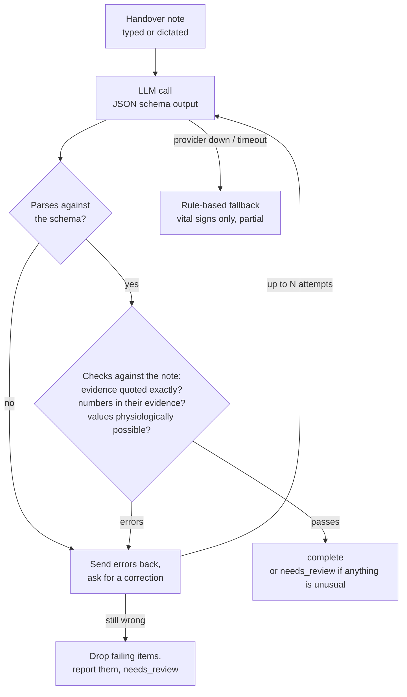

# Shiftnote

Nurses hand over patients at every shift change, usually as a rushed spoken or scribbled note. Shiftnote turns that note, typed or dictated, in English, German or Indonesian, into structured care documentation: vital signs, medications, tasks for the next shift, risks and observations.

The interesting part isn't calling an LLM. It's making the output trustworthy enough to file:

- **Nothing invented gets through.** Every extracted item must quote the words it came from, and the quote must actually be in the note.
- **Wrong numbers are caught.** A heart rate of 29 when the note says 92 is rejected, and so are impossible vitals.
- **The model fixes its own mistakes.** Errors are sent back to it with the exact problem; anything still wrong after that is removed and reported.
- **It never leaves a nurse with nothing.** If the provider is down or keeps failing, a rule-based fallback still extracts the vital signs and marks the note for review.
- **Quality is measured, not guessed.** An evaluation suite scores every prompt, model or provider change against annotated notes.

Stack: Python 3.12, FastAPI, Pydantic, httpx, pytest. Works with OpenAI, Anthropic or Gemini, or offline with no key.

## How it works



| Status | Meaning |
|---|---|
| `complete` | Every item was grounded in the note and passed the checks |
| `needs_review` | Usable, but has unusual values (e.g. SpO₂ 86%), items the checks removed, or things the model flagged as unclear |
| `partial` | The LLM was unavailable or unusable; only rule-extracted vital signs. The note is never lost |

### Design decisions

**Evidence quoting (grounding).** The schema requires an `evidence` field on every item: the exact words from the note. [`validate.py`](src/shiftnote/validate.py) checks that the quote exists in the note (ignoring case, spacing and `38,2` vs `38.2`). That turns "did the model hallucinate?" into a string check, and it lets the UI highlight where each item came from.

**Numbers must be in their own evidence.** A model can quote the right sentence and still copy the wrong number. Every vital's value has to appear in its evidence.

**Clinical plausibility in two tiers.** Impossible values (heart rate 300, diastolic above systolic) are errors that trigger a repair. Possible but notable values (temperature 38.4, SpO₂ 88%) are warnings: the item stays and the note goes to review.

**Repair, then remove.** On errors, the model sees its previous answer and a list of exactly what was wrong. If the same errors survive, the bad items are dropped and listed as "Removed" instead of failing the whole note.

**Ambiguity is flagged, not guessed.** The prompt tells the model to leave unclear doses or readings out of the structured fields and list them under `uncertainties`. The eval suite has a case that checks for exactly this.

**Fallback over failure.** In care settings a blank screen is worse than a partial answer. Provider outages, timeouts, rate limits and repeated schema failures all end in the rule-based extractor, which knows English, German and Indonesian shorthand (`RR 160/95` is blood pressure, `Atemfrequenz 24` is respiratory rate, `tensi`, `nadi`, `suhu`…).

**Plain HTTP adapters.** Each provider is about 30 lines on `httpx` instead of three vendor SDKs: one timeout and error policy, easy to read, and tested against recorded response shapes.

**Patient data stays out of logs.** The note text is never logged, and error messages from providers are truncated.

## Evaluation

```bash
python -m shiftnote.evals                                   # offline mock
SHIFTNOTE_PROVIDER=openai SHIFTNOTE_API_KEY=sk-... \
  python -m shiftnote.evals --out evals/report-openai.md    # a real model
```

[`evals/cases/`](evals/cases) holds synthetic handover notes in English, German, Indonesian and a mix, each annotated with what a nurse would expect to be extracted. They include deliberately tricky ones: a refused and a held medication, a note with no vital signs, German `RR` meaning blood pressure, and an unclear morphine dose that must be flagged rather than guessed.

The report scores vitals precision and recall, medications found and their status (given, refused, held), next-shift tasks, risk flags, ambiguity handling, invented items caught, fallback rate, attempts and latency, overall and per case.

Baseline, offline rules only ([full report](evals/report-mock.md)):

| Metric | Rules only |
|---|---|
| Vitals precision / recall | 100% / 93% |
| Medications found | 0% |
| Next-shift tasks found | 36% |
| Risk flags recall | 0% |

The rules find vital signs and nothing else; the gap to the LLM results is what the model adds. Run the suite with your provider and add its report next to this one.

## Run it

### Locally
```bash
python -m venv .venv && source .venv/bin/activate
pip install -e ".[dev]"
uvicorn shiftnote.api:app --reload
```
Open http://localhost:8000, pick an example or press **Dictate** (Chrome or Edge), then **Structure note**. Hover any item to see the words it came from.

With no configuration it runs on the offline mock. To use a real model, copy `.env.example` to `.env` and set:
```bash
SHIFTNOTE_PROVIDER=openai        # or anthropic, gemini
SHIFTNOTE_API_KEY=...
SHIFTNOTE_MODEL=                 # optional; each provider has a small, fast default
```
`SHIFTNOTE_BASE_URL` points the OpenAI adapter at any OpenAI-compatible server, including local model servers.

### Docker
```bash
docker build -t shiftnote .
docker run -p 8000:8000 -e SHIFTNOTE_PROVIDER=anthropic -e SHIFTNOTE_API_KEY=... shiftnote
```

### Tests
```bash
pytest           # 33 tests: validation, fallback, repair loop, providers, API, eval scoring
ruff check . && ruff format --check .
```
CI runs lint, tests, an offline evaluation with a minimum score, and the Docker build on every push. A manual workflow runs the evaluation against a real provider (API key stored as a repository secret) and uploads the report.

## API

| Method | Path | |
|---|---|---|
| POST | `/v1/notes/structure` | `{ "text": "..." }` → `{ status, note, issues, source, provider, model, attempts, latency_ms }` |
| GET | `/health` | Provider and model in use |
| GET | `/docs` | Interactive OpenAPI docs |
| GET | `/` | Demo page |

## Project layout
```
src/shiftnote/
  models.py         care-note schema (Pydantic), result envelope
  prompt.py         system, user and repair prompts
  pipeline.py       call -> validate -> repair -> remove / fall back
  validate.py       grounding, number and plausibility checks
  fallback.py       rule-based extraction (EN / DE / ID)
  providers/        OpenAI, Anthropic, Gemini adapters, offline mock
  evals.py          evaluation runner and report
  api.py            FastAPI app
  static/index.html demo page with dictation and evidence highlighting
evals/cases/        annotated synthetic notes
tests/
```

## Limits

- Synthetic notes only. This is a portfolio project, not a medical device. Don't put real patient data into it.
- Dictation uses the browser's speech recognition, so the server only ever receives text.
- Eight evaluation cases are enough to compare prompts and models, not to claim clinical accuracy.

## License
MIT
